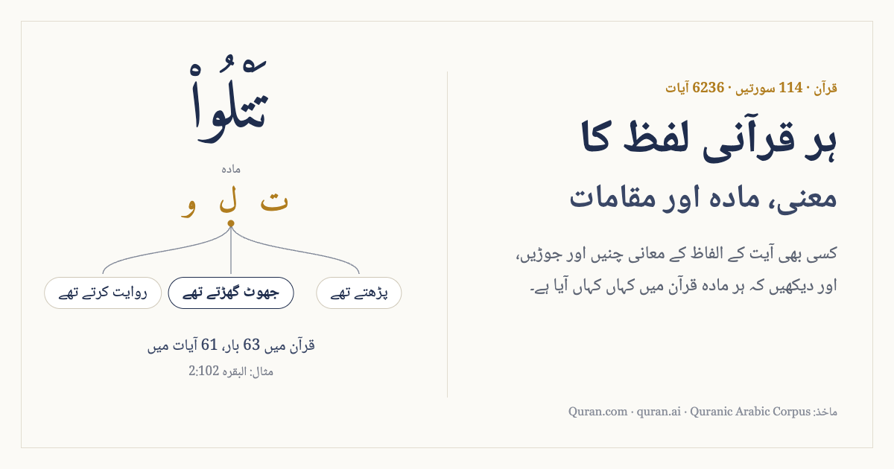

# Quranic Words: Meaning, Root & Occurrences

**قرآنی الفاظ: معنی، مادہ اور مقامات**



A study canvas for the Quran. Add any ayah, or several, choose a meaning for each word, and link meanings across words and ayahs to see how the reading of a verse changes. Tap any word to see its root, lemma and grammar, how often its root occurs in the Quran, and every surah and ayah where it appears.

The interface is in Urdu. Everything runs in the browser: no account, no server, no API keys.

> The word-by-word reading the app builds from your choices is a study aid, not a tafsir.

## Features

- **Any ayah** from all 114 surahs, several at once, with links between words of different ayahs.
- **Meanings for every word:** Urdu and English word-by-word translations, your own meanings with a source note, and hand-curated tafsir meanings for Al-Baqarah 2:102.
- **Root and grammar:** root, lemma, part of speech, person, gender, number, tense, mood, case and verb form.
- **Concordance:** every occurrence of a word's root (or lemma) in the Quran, grouped by surah. Tap one to add that ayah.
- **15 translations** (7 Urdu, 8 English) and **24 tafsirs**: 17 classical Arabic (including Jalalayn, Qurtubi, Abu Hayyan's al-Bahr al-Muhit, Tabari, Razi, Zamakhshari, Ibn Ashur), 4 Urdu and 3 English.
- Light and dark theme, works on phones, can be added to the home screen.

## How to use

### 1. Add ayahs (آیات)

1. Type a surah's number or name in **سورہ: نمبر یا نام**, or pick it from the dropdown. Names work in Arabic, Urdu spelling or English: `2`, `البقرة`, `بقرہ`, `baqarah`. Press Enter.
2. Type the ayah number in **آیت**. For a range, also fill **تک** (up to 20 ayahs at a time).
3. Press **شامل کریں**.

Shortcut: type `2:255` or `2:1-5` straight into the **آیت** box.

Added ayahs appear as chips. Tap a chip to jump to that ayah on the canvas; tap **×** to remove it.

### 2. Read the canvas

- Each ayah is a block of word cards, in reading order (right to left).
- A card shows the word, its position in the ayah and its root (for example ت ل و).
- The rounded pills under the word are its possible meanings. The dot's colour shows where a meaning comes from; see **رنگ کس ماخذ کا ہے** in the panel.

### 3. Choose meanings

- Tap a pill to choose that meaning.
- **آپ کے انتخاب سے بنتا مطلب** shows each ayah read with your choices. Choices other than the first meaning are underlined; your own meanings are gold.
- When 2:102 is on the canvas, **مفسرین کی قراءتیں** applies the reading of a mufassir (Jalalayn, Qurtubi and others) and shows which reading your choices match.

### 4. Study a word (منتخب لفظ)

- Tap the word itself, at the top of a card, to open its details: root, lemma, grammar, and how often the root occurs (for example *قرآن میں 63 بار، 61 آیات میں*).
- Press **… مقامات دکھائیں** to list every occurrence, grouped by surah. Switch between root (**مادہ**) and lemma (**لیما**).
- Tap any occurrence to add that ayah to the canvas.
- Other words on the canvas with the same root are outlined in teal.

### 5. Add your own meaning

In the word details, under **اپنا معنی شامل کریں**, write the meaning (and, if you like, its source) and press **شامل کریں**. It becomes a gold pill you can choose and link like any other. Remove it with **×**.

### 6. Link meanings

- **Desktop:** drag a pill onto a pill of another word.
- **Phone (or anywhere):** select a pill, press **اس سے لنک بنائیں**, then tap a pill on another word.

Links can join words in different ayahs. Connected links form chains under **آپ کی زنجیریں**:

- **یہ زنجیر بطور مطلب چنیں** selects every meaning in a chain.
- **زنجیریں کاپی کریں** copies all chains as text.
- To remove a link, tap it on the canvas and press **✕ منتخب لنک ہٹائیں**, or press **×** next to it in the chains list.

### 7. Tafsir and translations

- **تفسیر** shows the chosen tafsir for the ayah of the selected word. Pick another tafsir from the list.
- **ترجمے اور ترتیبات** sets which translations appear under each ayah, and whether cards also show English word meanings.

### 8. Moving around

| | Desktop | Phone |
|---|---|---|
| Move the canvas | Drag empty space, or scroll | Drag with one finger |
| Zoom | Pinch on a trackpad, Ctrl + scroll, or **+** / **−** | Pinch with two fingers |
| Move a card | Drag the word | Drag the word |

**پورا دکھائیں** fits everything on screen, **ترتیب بحال کریں** puts cards back in order, **☾ / ☀** switches the theme, and on desktop you can drag the line between the panel and the canvas to resize them.

### Your data

Your ayahs, choices, links and own meanings are saved in your own browser (localStorage). There is no account, and nothing is sent anywhere except requests for Quran data. Clearing your browser's site data erases your work, so use **زنجیریں کاپی کریں** to keep a copy.

---

## For developers

### Overview

A static site: plain HTML, CSS and JavaScript. No framework, no build step, no dependencies to install, no server code. All Quran data is fetched at runtime from two public APIs, directly from the visitor's browser.

### Project structure

```
index.html            page, security policy (CSP), meta tags
css/app.css           all styles; light and dark colour tokens at the top
js/app.js             the whole app
data/surahs.js        114 surahs: Arabic name, transliteration, Urdu meaning, ayah count
data/curated.js       hand-curated meanings and mufassir readings (2:102)
assets/               icons and the link-preview image
manifest.webmanifest  home-screen / install metadata
favicon.ico           kept at the root, where browsers look for it
sitemap.xml           for search engines
robots.txt            lets search engines index the site and points them to the sitemap
.htaccess             HTTPS and security headers for Apache / LiteSpeed hosts
_headers              the same headers for Netlify / Cloudflare Pages
```

### Run locally

```sh
python3 -m http.server 8000
```

Then open http://localhost:8000. Use a local server rather than opening `index.html` from disk, so the security policy and browser storage behave as they do in production. An internet connection is needed for the Quran data and fonts.

### Data sources

| Data | Source | Call |
|---|---|---|
| Ayah text (Uthmani), Urdu and English word-by-word, transliteration | Quran.com API v4 | `GET /verses/by_key/{key}?words=true&language=ur` (and `language=en`) |
| Verse translations | Quran.com API v4 | `GET /quran/translations/{id}?verse_key={key}` |
| Urdu tafsirs | Quran.com API v4 | `GET /tafsirs/{id}/by_ayah/{key}` |
| Root, lemma, grammar, root and lemma counts | quran.ai MCP | `fetch_word_morphology {ayah_key}`, one call per ayah |
| All occurrences of a root or lemma | quran.ai MCP | `fetch_word_concordance {ayah_key, word_position, match_by, group_by:"word", page_size:100}` |
| Arabic and English tafsirs | quran.ai MCP | `fetch_tafsir {ayahs, editions, grounding_nonce}` |

Both APIs are public, need no keys and allow cross-origin requests. Quran.com base URL: `https://api.quran.com/api/v4`. MCP endpoint: `https://mcp.quran.ai/`.

### The MCP client

`js/app.js` contains a small MCP client (`MCP`) that speaks JSON-RPC over Streamable HTTP: `initialize`, then `notifications/initialized`, then `tools/call`, keeping the `mcp-session-id` header between calls.

- The public server allows unverified clients **one tool call per second**, so calls go through a queue spaced 1.1 s apart.
- Calls for what the user just tapped jump the queue.
- `rate_limited` replies are retried after `retry_after_seconds`, and an expired session is re-initialised.
- `fetch_tafsir` needs a grounding nonce, fetched once per session from `fetch_grounding_rules`.

Don't route these calls through your own server: every visitor would then share your server's single one-call-per-second limit.

### State and caching

- **User state** lives in localStorage under `maani-jaal-quran-v1`: ayahs, selected meanings, links, own meanings, card positions, view and settings. `sanitize()` validates it on load. Changing the key resets everyone's saved work.
- **API cache:** verses (`c1:v:`), morphology (`c1:m:`) and translations (`c1:t:`) are kept in localStorage. Change `CV` in `app.js` if you change the cached shape. Tafsir and occurrence lists are cached in memory only. If storage fills up, the cache is cleared (never the user's state).
- **Identifiers:**
  - word: `"surah:ayah:position"`, using Quran.com word positions
  - meaning keys: `ur`, `en`, `c:<key>` (curated), `u…` (user's own)
  - link: `{id, a:{w,k}, b:{w,k}, src}`, where `src` is `user` or `<ayah>#<presetId>`

### Adding curated meanings for another ayah

Add an entry to `window.CURATED` in `data/curated.js`, keyed by `"surah:ayah"`:

- `words`: one entry per word, in Quran.com order: `[arabic, [[key, gloss, source, detail, attributedTo], …]]`
- `presets` (optional): mufassir readings, as `sel {position: key}` and `links [[posA, keyA, posB, keyB]]`
- `sources`: `[name, url]` pairs shown under the credits

Source codes are `J` Jalalayn, `Q` Qurtubi, `B` Abu Hayyan, `K` Ibn Kathir, `M` literal/grammatical. For a new source, add it to `SRC` in `app.js` and a `--s-<code>` colour in `app.css`.

The number and order of words must match Quran.com's word positions for that ayah. Check against `https://api.quran.com/api/v4/verses/by_key/{key}?words=true`, ignoring the final `end` marker.

### Adding a translation or tafsir

- **Translation:** add `[id, "ur" | "en", name]` to `TRANS` in `app.js`. IDs: `https://api.quran.com/api/v4/resources/translations`.
- **Tafsir:** add to `TAFSIRS` either `"qc:<id>"` (Quran.com, IDs from `/resources/tafsirs`) or `"mcp:<edition_id>"` (quran.ai, from the `list_editions` tool with `edition_type: "tafsir"`).

### Regenerating `data/surahs.js`

```sh
curl -s "https://api.quran.com/api/v4/chapters?language=ur" | python3 -c 'import json,sys; c=json.load(sys.stdin)["chapters"]; print("window.SURAHS="+json.dumps([[x["name_arabic"],x["name_simple"],x["translated_name"]["name"],x["verses_count"]] for x in c],ensure_ascii=False,separators=(",",":"))+";")' > data/surahs.js
```

### Security model

- There are no secrets in the code.
- The Content Security Policy in `index.html` lets the page run only its own scripts and talk only to `api.quran.com` and `mcp.quran.ai` (plus Google Fonts for styles and fonts). **If you add an API, add it to `connect-src`**, or the browser will block it.
- API responses and localStorage are treated as untrusted: ayah and word IDs are checked against the real mushaf (`validAyah`, `validWord`), numbers are forced to numbers (`int`), tafsir HTML is parsed inert with `DOMParser` and shown as text only, and every other value is escaped (`esc`) before it reaches `innerHTML`.
- `.htaccess` and `_headers` add HTTPS redirect and HSTS, block framing by other sites, and set `nosniff`, referrer and permissions policies. `.htaccess` also blocks hidden files and folder listings.

### Deploying

1. Turn on HTTPS for the domain first; `.htaccess` redirects every visitor to HTTPS.
2. Upload the repository contents (without `.git` and `_dev`) to the web root, usually `public_html`. `.htaccess` is a hidden file, so enable "show hidden files" in your FTP client or file manager.
3. Replace `YOUR-DOMAIN.com` in `index.html` (`og:image`), `sitemap.xml` and `robots.txt`.
4. If the host shows "500 Internal Server Error", delete the `Options -Indexes` line in `.htaccess`.
5. Search engines find the sitemap through `robots.txt`. To get indexed sooner, also submit `https://<your-domain>/sitemap.xml` in Google Search Console.

### Browser support

Current Chrome, Edge, Firefox and Safari, on desktop and mobile. The app uses `AbortSignal.timeout` (Chrome 103+, Firefox 100+, Safari 16+).

### Testing

There is no automated test suite in this repository. After a change, check in a desktop and a phone-sized window, with the browser console open:

- add ayahs by number, by name and as `2:255`
- root badges appear on cards
- word details and the occurrence list load
- tafsir loads, both an Arabic one (quran.ai) and an Urdu one (Quran.com)
- linking works by dragging and with **اس سے لنک بنائیں**
- the console shows no errors and no Content Security Policy violations

## Sources and credits

- **Quran text, word-by-word translations, verse translations, Urdu tafsirs:** [Quran.com API](https://api-docs.quran.foundation/) (Quran Foundation).
- **Roots, lemmas, grammar, occurrences, Arabic and English tafsirs:** the [quran.ai](https://quran.ai) MCP server ([quran-mcp](https://github.com/quran/quran-mcp), Quran Foundation). Its morphology is based on the [Quranic Arabic Corpus](https://corpus.quran.com).
- **Curated 2:102 meanings:** Tafsir al-Jalalayn, al-Qurtubi's *al-Jami' li-Ahkam al-Quran*, Abu Hayyan's *al-Bahr al-Muhit* and Tafsir Ibn Kathir.
- **Fonts:** Amiri Quran, Amiri and Noto Naskh Arabic, via Google Fonts (SIL Open Font License).

quran-mcp is licensed under QFGPL-1.0, which allows non-commercial use only. Quran data belongs to its respective rights holders; this project fetches it live and does not redistribute it.
